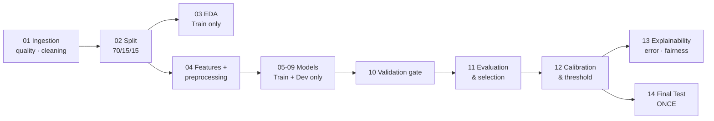

# Hotel Booking Cancellation Prediction

Predict, **at booking time**, the probability that a hotel booking will be cancelled.
The output is a calibrated risk score and a Low / Medium / High tier for a reservations
team. It is a **decision-support score**, never an automatic action against a guest.

| | |
|---|---|
| **Task** | Supervised binary classification of `is_canceled` |
| **Unit of analysis** | One booking (one row) |
| **Primary metric** | PR-AUC (accuracy alone is misleading at ~27 % prevalence) |
| **Dataset** | [Hotel Booking Demand](https://www.kaggle.com/datasets/jessemostipak/hotel-booking-demand) (Antonio, de Almeida & Nunes, 2019): 119,390 rows × 32 columns, 87,138 after de-duplication |
| **Models** | Dummy baselines · Logistic Regression · Decision Tree · Random Forest · XGBoost · SVM (RBF) |
| **Team** | Bhanuka Samarasinghe · Seneja Ramanayake · Jayashan Guruge · Hasitha Erandika |

> **Start here:** [`plan.md`](plan.md) has the implementation plan, the issue audit, the
> notebook catalogue, the best practices and the roadmap. The `docs/` folder holds the
> rubric-mapped project documentation.

---

## Quick start

```bash
# 1. Create and activate a Python 3.11 environment
python3.11 -m venv .venv
source .venv/bin/activate            # Windows: .venv\Scripts\activate

# 2. Install dependencies
pip install -r requirements.txt

# 3. Verify the dataset fingerprint (must match docs/08-reproducibility.md)
sha256sum data/hotel_bookings.csv
# 7c2ae42a7353905ea136e5c2287f17c92c5435826598bfbb8491c6f0c7b1fc06

# 4. Open the notebooks (or use VS Code with the Python 3.11 kernel)
jupyter lab notebooks/
```

Run the notebooks **in numeric order** with *Restart Kernel & Run All*. Each notebook
finds the project root itself, so it works from VS Code or Jupyter.

---

## Pipeline



| # | Notebook | Owner | What it does |
|---|---|---|---|
| 01 | `01_data_ingestion_quality_cleaning` | Bhanuka | SHA-256 check, schema contract, data-quality profile, leakage proof, doc reconciliation, rule-based cleaning |
| 02 | `02_train_dev_test_split` | Seneja | Stratified 70/15/15 split with ID- and content-level disjointness checks |
| 03 | `03_exploratory_data_analysis` | Bhanuka | Target-relationship EDA on Train only, with confidence intervals and a leakage-suspect audit |
| 04 | `04_feature_engineering_preprocessing` | Seneja | Stateless features, day-zero / full-lifecycle feature spec, sklearn-native preprocessing templates |
| 05 | `05_baseline_logistic_regression` | Bhanuka | Dummy baselines + Logistic Regression, odds ratios |
| 06 | `06_decision_tree` | Seneja | Depth-limited tree, over-fitting curve, human-readable rules |
| 07 | `07_random_forest` | Seneja | Random Forest, impurity vs permutation importance |
| 08 | `08_xgboost_tuning` | Jayashan | Randomised search, early stopping on Dev, learning curve |
| 09 | `09_svm_rbf` | Hasitha | RBF-SVM: subsample search + calibrated full-Train fit |
| 10 | `10_validation_gate` | Hasitha | 12 executable leakage / integrity checks; per-model eligibility |
| 11 | `11_model_evaluation_comparison` | Hasitha | Unified metrics, CV mean ± SD, bootstrap CIs, corrected t-test, rule-based selection |
| 12 | `12_calibration_threshold_policy` | Hasitha | Cross-fitted calibration, cost-based threshold, risk tiers, **locked policy** |
| 13 | `13_explainability_error_fairness` | Hasitha | Permutation importance, SHAP, error profile, fairness audit |
| 14 | `14_final_test_evaluation` | Hasitha | One-time Test scoring with a lock file, plus a temporal robustness check |

Notebooks 05–09 are independent of each other, so members can run them in parallel.
All of them must finish before notebook 10.

**Typical runtimes** (8-core laptop): 01–04 under 2 min each, 05–06 a few minutes, 07–08
about 15–25 min, 09 about 20–40 min, 10–14 a few minutes. Search budgets (`N_ITER`,
sample sizes) sit in each notebook's configuration cell.

---

## How the notebooks share work

There is **no shared Python package**. Notebooks communicate through versioned
**artifacts**, and every downstream notebook re-checks the hashes of its inputs:

| Artifact | Written by | Used by |
|---|---|---|
| `data/interim/hotel_bookings_clean.csv` + `artifacts/data_contract.json` | 01 | 02, 10 |
| `data/processed/splits/*.csv` + `artifacts/split_manifest.json` | 02 | 03, 04, 10 |
| `data/processed/features/*.csv` + `artifacts/feature_spec.json` + `artifacts/preprocessors/*.joblib` | 04 | 05–14 |
| `models/<model_id>.joblib` + `artifacts/model_outputs/<model_id>/` (model card, CV folds, Dev predictions) | 05–09 | 10–14 |
| `artifacts/validation_gate_report.json` | 10 | 11, 14 |
| `artifacts/model_selection.json` | 11 | 12 |
| `artifacts/decision_policy.json` + `models/final_model_calibrated.joblib` | 12 | 13, 14 |
| `artifacts/test_evaluation_lock.json` | 14 | 14 (re-run guard) |

`model_id` = `<model>__<variant>`, e.g. `xgboost__day_zero`.

## Leakage-safe rules (enforced in code, not just documented)

1. `reservation_status` and `reservation_status_date` encode the label. They are dropped
   in 01 and asserted absent everywhere downstream.
2. De-duplication happens **before** the split. Notebooks 02 and 10 verify that no
   identical row content appears in two splits.
3. Everything learned from data (imputers, encoders, scalers, the ADR cap) is fitted on
   **Train only**, inside an sklearn `Pipeline`. Notebook 10 refits each preprocessor on
   Train and checks that its learned state is identical.
4. The **day-zero** variant excludes post-booking fields (`booking_changes`,
   `days_in_waiting_list`, `required_car_parking_spaces`, `assigned_room_type`,
   `room_type_changed`). The **full-lifecycle** variant includes them and is reported separately.
5. Hyper-parameter search uses Train CV only. Calibration and thresholds use Dev only.
6. **Test is read once**, in notebook 14, behind a hashed policy and a lock file.
   Notebook 10 statically scans the model notebooks for any reference to Test.

## Repository layout

```text
├── data/
│   ├── hotel_bookings.csv        # raw, immutable (tracked)
│   ├── interim/  processed/      # generated (git-ignored)
├── notebooks/                    # 01-14 pipeline notebooks
├── artifacts/                    # JSON contracts + model outputs (tracked); *.joblib ignored
├── models/                       # fitted pipelines (git-ignored, regenerated)
├── reports/
│   ├── figures/                  # NN_*.png used in the report
│   └── tables/                   # CSV evidence behind every reported number
├── docs/                         # rubric-mapped documentation (01-08), team roles,
│                                 # DECISIONS.md (decision log), PROGRESS.md (status)
├── ai-usage-disclosure/          # per-member AI-use logs
├── plan.md                       # implementation plan, issue audit, roadmap
└── requirements.txt
```

## Team workflow

- Work on a feature branch and open a PR. At least one other member reviews it (Definition of Done).
- Add a row to [`docs/DECISIONS.md`](docs/DECISIONS.md) for every non-trivial choice, when you make it.
- Keep [`docs/PROGRESS.md`](docs/PROGRESS.md) current, and log AI-tool use in `ai-usage-disclosure/<you>.md` as you go.
- Before committing a notebook: *Restart & Run All* must succeed, and every number quoted in
  `docs/` must match a file in `reports/tables/`.

## Documentation

| Topic | File |
|---|---|
| Business problem & framing | [`docs/01-business-problem-framing.md`](docs/01-business-problem-framing.md) |
| Workflow & architecture | [`docs/02-workflow-and-architecture.md`](docs/02-workflow-and-architecture.md) |
| Data understanding & quality | [`docs/03-data-understanding.md`](docs/03-data-understanding.md) |
| Preprocessing & features | [`docs/04-preprocessing-feature-engineering.md`](docs/04-preprocessing-feature-engineering.md) |
| Modelling strategy | [`docs/05-modeling-strategy.md`](docs/05-modeling-strategy.md) |
| Evaluation plan | [`docs/06-evaluation-plan.md`](docs/06-evaluation-plan.md) |
| Recommendation & limitations | [`docs/07-recommendation-limitations.md`](docs/07-recommendation-limitations.md) |
| Reproducibility & AI use | [`docs/08-reproducibility.md`](docs/08-reproducibility.md) |
| Roles & RACI | [`docs/team/roles-and-raci.md`](docs/team/roles-and-raci.md) |
| Decision log | [`docs/DECISIONS.md`](docs/DECISIONS.md) |
| Progress tracker | [`docs/PROGRESS.md`](docs/PROGRESS.md) |

All docs use the de-duplicated numbers (87,138 rows, 27.28% cancelled) and the
notebook-only pipeline. If a doc and a notebook disagree, the notebook is right.

## Data source & citation

Antonio, N., de Almeida, A., & Nunes, L. (2019). Hotel booking demand datasets.
*Data in Brief*, 22, 41–49. Redistributed on Kaggle by Jesse Mostipak.
