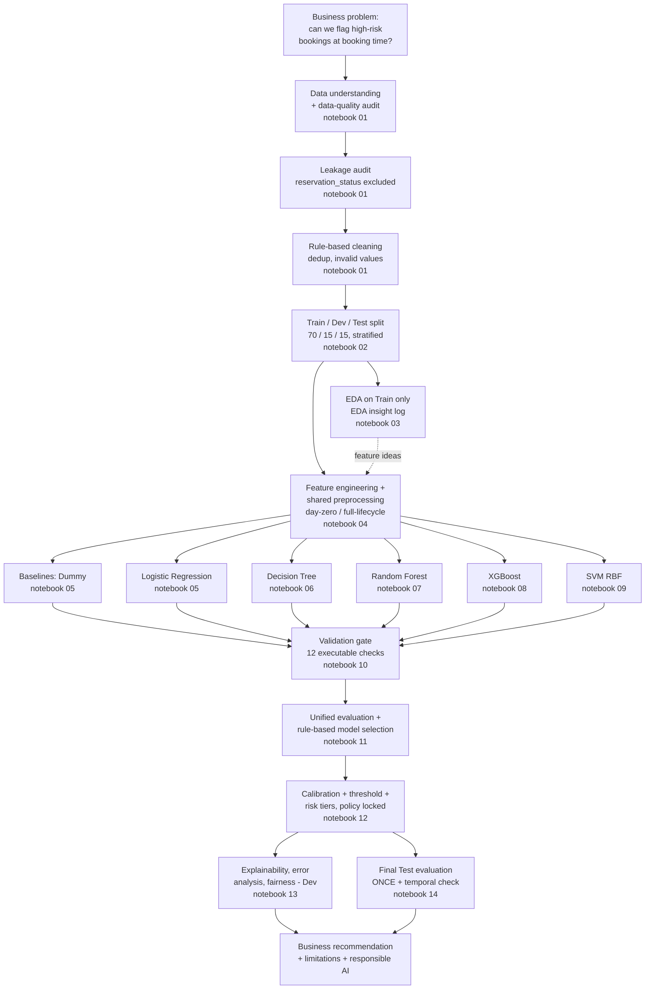
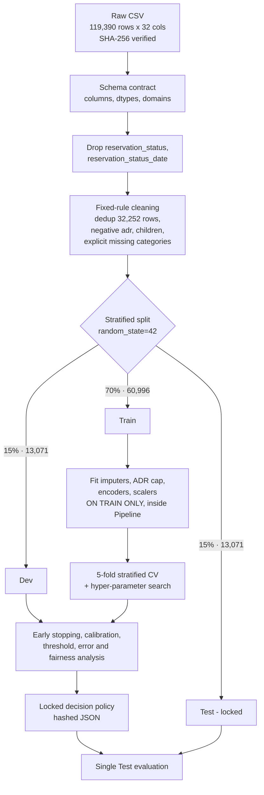
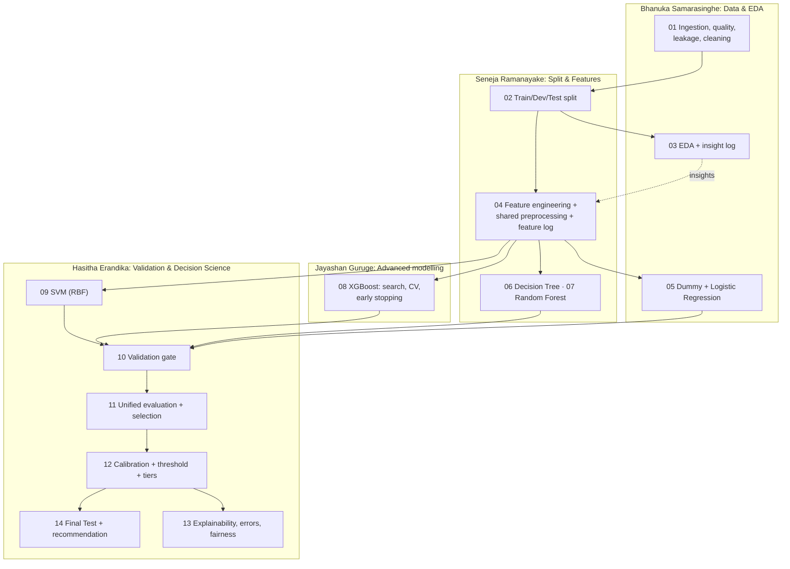

# 2. Workflow Diagram and Architecture

*Rubric: 10 marks. Integration; Learning How to Learn | Reasoning; communication*

This file is the single source of truth for how the project is structured end to
end. The **decision log with options, reasons and evidence lives in
[`DECISIONS.md`](DECISIONS.md)**. This file shows the *shape* of the workflow;
`DECISIONS.md` shows *why* each stage was built the way it was. The implementation
plan and issue audit are in [`../plan.md`](../plan.md).

## 2.1 End-to-end workflow: business problem → recommendation



## 2.2 Data pipeline architecture (leakage-safe)



The critical rules enforced by this diagram:

- **Fixed rules before the split, learned statistics after it.** Dropping a column,
  removing exact duplicates or setting a negative price to 0 is safe before the split.
  Anything that needs to *look at* other rows (a median, a percentile cap, a category
  list, a scale) is fitted on Train only.
- **One preprocessing contract.** Notebook 04 saves unfitted, sklearn-native
  `ColumnTransformer` templates. Each model wraps one in a `Pipeline`, so
  cross-validation refits it inside every fold, and no member can fit their own
  preprocessing on the full dataset.
- **Roles of the splits.** Train is for fitting and CV. Dev is for early stopping,
  calibration and threshold choice. Test is read once, by notebook 14 only.

## 2.3 Team / module ownership architecture



Everyone consumes the **same** cleaned dataset (notebook 01), the **same** split
(notebook 02) and the **same** preprocessing templates (notebook 04). This prevents the
classic group-project failure where each member trains on a slightly different
version of the data and the results become incomparable. Every member also trains at
least one model end-to-end (decision #18). See
[`team/roles-and-raci.md`](team/roles-and-raci.md) for the RACI matrix.

## 2.4 How notebooks hand work to each other

There is no shared Python package (decision #24). Notebooks communicate through
versioned **artifacts**, and every notebook re-hashes its inputs against the record
written by the notebook that produced them:

| Artifact | Producer | Consumers |
|---|---|---|
| `data/interim/hotel_bookings_clean.csv`, `artifacts/data_contract.json` | 01 | 02, 10 |
| `data/processed/splits/{train,dev,test}.csv`, `artifacts/split_manifest.json` | 02 | 03, 04, 10 |
| `data/processed/features/*.csv`, `artifacts/feature_spec.json`, `artifacts/preprocessors/*.joblib` | 04 | 05–14 |
| `models/<model_id>.joblib`, `artifacts/model_outputs/<model_id>/model_card.json` (+ CV folds, Dev predictions) | 05–09 | 10–14 |
| `artifacts/validation_gate_report.json` | 10 | 11, 14 |
| `artifacts/model_selection.json` | 11 | 12 |
| `artifacts/decision_policy.json`, `models/final_model_calibrated.joblib` | 12 | 13, 14 |
| `artifacts/test_evaluation_lock.json` | 14 | 14 (re-run guard) |

## 2.5 Repository structure

```text
hotel-booking-cancellation-ml/
├── data/
│   ├── hotel_bookings.csv          # raw, untouched; never edited in place
│   ├── interim/                    # notebook 01 output (git-ignored)
│   └── processed/                  # notebook 02 / 04 outputs (git-ignored)
├── notebooks/                      # 01 → 14, one stage / one owner each
├── artifacts/                      # JSON contracts + per-model outputs
├── models/                         # fitted pipelines (git-ignored, regenerated)
├── reports/
│   ├── figures/                    # NN_*.png charts used in the final report
│   └── tables/                     # CSV evidence behind every reported number
├── docs/                           # this documentation
│   ├── DECISIONS.md                # decision log: options, choice, reason, evidence
│   ├── PROGRESS.md                 # live status tracker
│   └── team/
├── ai-usage-disclosure/            # per-member AI-use logs
├── plan.md                         # implementation plan, issue audit, roadmap
└── README.md
```

## 2.6 How to use the decision log

Every non-trivial choice referenced in this workflow (how missing values are
treated, which variables are dropped for leakage, which models are compared, which
metric decides the "winner") must have a row in [`DECISIONS.md`](DECISIONS.md) with
the alternatives considered, the choice made, the reason, and the evidence that
supports it. Evidence should point to a notebook section or a file in
`reports/tables/`. This file is graded directly against rubric criterion 2, so it is
not optional bookkeeping. It is the primary evidence of reasoning.
