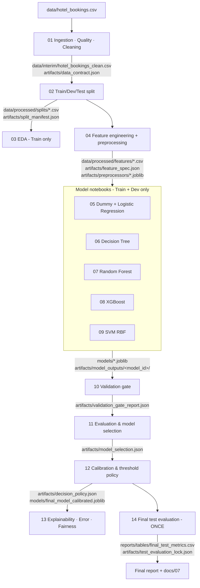

# Implementation Plan: Hotel Booking Cancellation Prediction

> Status: **active** · Last revised: 2026-10-11 · Maintainer: Hasitha Erandika (Member 4)
>
> This plan replaces the `src/` package with a **notebook-only, artifact-driven
> pipeline**. Each team member owns one or more notebooks. Notebooks share their
> results through versioned files on disk (data files, JSON contracts and
> `joblib` models), not through imported Python modules. The plan lists:
> (1) what exists today, (2) the issues found in it, (3) the target notebook
> set, (4) the engineering practices every notebook follows, and (5) what is
> left for later.

---

## 0. TL;DR

| Item | Decision |
|---|---|
| Architecture | `src/` removed. 14 numbered notebooks (`notebooks/01_…` → `notebooks/14_…`), each with one owner and one job. |
| Hand-off mechanism | Notebooks talk via **artifacts**: CSV data files + JSON contracts (`artifacts/*.json`) + fitted sklearn pipelines (`models/*.joblib`). Every artifact carries a SHA-256 so the downstream notebook can verify it is reading what the upstream notebook wrote. |
| Shared preprocessing | Built from **sklearn-native components only** (no custom classes, no lambdas) so the pipeline pickles cleanly and loads in any notebook without re-declaring code. |
| Test set | Read by **exactly one** notebook (`14_final_test_evaluation`), guarded by a lock file. The validation gate (`10_…`) statically scans model notebooks to prove they never reference test data. |
| Kernel | Python 3.11 (the team's selected kernel). |
| Biggest new findings | (a) After de-duplication the cancellation rate is **27.28 %**, not 37.04 %. Several documented numbers are pre-dedup and stale. (b) `required_car_parking_spaces > 0` → **0 %** cancellation (7,313 rows), so it is very likely recorded at arrival and must leave the *day-zero* variant. (c) The engineered `room_type_changed` feature was silently dropped by the legacy pipeline. |

---

## 1. Current-state analysis (before this plan)

### 1.1 What exists

| Area | State |
|---|---|
| `docs/01–08` | Thorough, rubric-mapped planning docs. Decisions 1–20 in `DECISIONS.md`. |
| `src/data/` (now removed) | `ingestion.py` (CSV load), `cleaning.py` (drop leakage cols + dedup), `validation.py` (2 assertions). |
| `notebooks/01_data_quality_eda.ipynb` | Loads data, leakage crosstab, cleaning, 4 EDA plots. |
| `notebooks/01_train_dev_test_split.ipynb` | Stratified 70/15/15 split, overlap check, CSV export. |
| `notebooks/02_preprocessing_pipeline.ipynb` | Custom `HotelFeatureEngineer` + `TopNBucketer` transformers, `ColumnTransformer`, smoke test with a Decision Tree. |
| Models / evaluation | Nothing yet (Dummy, LR, DT, RF, XGB, SVM, validation gate, calibration, explainability all *Not started*). |

The three legacy notebooks were moved to `notebooks/legacy/` for reference.
Nothing was deleted from history.

### 1.2 Verified facts that drive this plan

Computed directly from `data/hotel_bookings.csv` on 2026-10-11:

| Fact | Value |
|---|---|
| Raw shape | 119,390 × 32 |
| Rows after dropping the 2 leakage columns and de-duplicating | **87,138** (32,252 duplicates removed) |
| Target after dedup | 63,371 not-cancelled / 23,767 cancelled → **27.28 % positive** |
| Majority-class accuracy after dedup | **72.72 %** (docs say 62.96 %, which is pre-dedup) |
| `scale_pos_weight` (neg/pos) after dedup | ≈ **2.67** |
| Feature-identical rows with conflicting labels | **265** groups |
| `required_car_parking_spaces > 0` | 7,313 bookings, **0.0 %** cancelled |
| `country == "PRT"` | 35.3 % cancelled vs 23.6 % for all others |
| Cancellation rate by arrival year | 2015: 20.0 % · 2016: 26.2 % · 2017: 31.7 % (drift) |
| `deposit_type == "Non Refund"` after dedup | only **1,017** rows (14,587 before dedup), 94.6 % cancelled |
| Zero-guest bookings after dedup | 166 |
| Zero-night stays after dedup | 651 |

---

## 2. Existing issues (audit)

Severity: 🔴 critical (invalidates results) · 🟠 high (biases results / breaks a
deliverable) · 🟡 medium (quality / maintainability) · ⚪ low (hygiene).

| # | Sev | Issue | Evidence | Resolution (where) |
|---|---|---|---|---|
| I-01 | 🔴 | **Class balance and baseline numbers in the docs are pre-dedup.** The 37.04 % positive rate, 62.96 % baseline, the split sizes (61,177 / 13,109 / 13,110) and the "~37 % positives per split" are all wrong for the modelling data. | Legacy split notebook printed 27.28 % positive and 60,996 / 13,071 / 13,071. | `01` reconciles every documented number against the data in a table. `02` records the true split sizes. Docs 03/04/05/06 to be updated (§9). |
| I-02 | 🟠 | **Dedup count mismatch** (docs 31,994 vs code 32,252). The code dedups *after* dropping `reservation_status*`, which also collapses rows that differ only in status date. | Legacy `clean_data` output. | Keep the code's behaviour (rows identical on every modelling column *are* the same training example) and log it as **D-21**. `01` reports both counts. |
| I-03 | 🟠 | **`required_car_parking_spaces` is a probable post-booking / arrival-time field.** 0 % cancellation for all 7,313 bookings with a parking request is not plausible for a booking-time signal. | Group-by above. | Excluded from the **day-zero** variant and kept in full-lifecycle (**D-22**). `03` visualises it. |
| I-04 | 🟠 | **`room_type_changed` was engineered but never used.** It is not in `NUMERIC_COLUMNS` and `remainder="drop"` silently discarded it, so the full-lifecycle variant was missing a planned feature. | Legacy `02_preprocessing_pipeline` cell 10/12. | The feature spec in `04` lists every column explicitly, and an assertion checks that every engineered feature is consumed by at least one variant. |
| I-05 | 🟠 | **Pipeline not picklable / not shareable.** `FunctionTransformer(lambda …)` and classes defined in a notebook (`__main__`) cannot be loaded by another notebook. This blocks the "one shared pipeline" contract. | Legacy `make_preprocessor`. | `04` builds the preprocessor from sklearn-native parts only: `OneHotEncoder(max_categories=…)` replaces `TopNBucketer`, and `FunctionTransformer(np.clip)` replaces the custom ADR cap. Unfitted templates are saved with `joblib`, and a reload test runs in the notebook. |
| I-06 | 🟠 | **No feature names after preprocessing** (`TopNBucketer` has no `get_feature_names_out`), so SHAP, coefficients and importances can't be labelled. | Legacy pipeline. | Native encoders give `get_feature_names_out()` end-to-end. |
| I-07 | 🟠 | **Test-set discipline not enforced in code.** Nothing prevented a member from scoring Test repeatedly. | - | Test is read only in `14` behind a lock file. `10` statically scans `05–09` for test references and checks every model card's `data_files_read`. |
| I-08 | 🟡 | **`arrival_date_year` used as a numeric feature.** The cancellation rate drifts 20 % → 32 % across years, and a model can't extrapolate a year it has never seen (2018+). | Year group-by above. | Excluded from features (**D-23**). `14` adds a temporal robustness check (train 2015–16 → test 2017). |
| I-09 | 🟡 | **265 feature-identical groups with conflicting labels** (irreducible noise). | Group-by above. | Reported in `01`, kept (removing them would hide real ambiguity), and noted as a ceiling on achievable accuracy. |
| I-10 | 🟡 | **Validation was trivial.** `validate_schema` checked 2 columns: no hash check, no dtype or category-domain checks, no reconciliation with the docs. | Legacy `validation.py`. | `01` has a full schema contract, SHA-256 check and doc-reconciliation table. `10` has a 12-check validation gate (G1–G5 global, M1–M7 per model). |
| I-11 | 🟡 | **Data-snooping risk in EDA.** Target-relationship EDA ran on the full dataset, including rows that later became Test. | Legacy `01` notebook. | Data-quality profiling (target-agnostic) stays on full data in `01`. All target-relationship EDA moves to `03` and runs on **Train only**. |
| I-12 | 🟡 | **Fragile CSV round-trip.** `agent`/`company` came back as floats (`9.0`). Categorical dtypes weren't enforced on reload, and pandas' default `na_values` treats strings like `"None"`/`"NA"` as missing. | Legacy splits. | IDs normalised to clean strings (`"9"`, `"No Agent"`) in `01`. Every loader passes an explicit `dtype=` map, and placeholder labels avoid pandas' NA tokens. |
| I-13 | 🟡 | **Duplicate notebook numbering** (two `01_*` files) and no stated run order. | `notebooks/`. | Strict `01`→`14` numbering, documented in `README.md`. |
| I-14 | 🟡 | **Docs drift.** `02-workflow` shows an 80/20 split and 4 models, the ownership diagram omits DT and SVM, docs 02/04/08 and team files reference `src/` modules that no longer exist, and doc 08 says notebooks `01..07`. | `docs/`. | Listed in §9 for the team to update. |
| I-15 | 🟡 | **`country` may be partly post-booking.** Hotels often confirm nationality at check-in, and PRT bookings cancel much more (35 % vs 24 %). This is a *hypothesis*, not yet proven. | Group-by above. | `03` tests it. `13` runs a with/without-`country` ablation (future item F-03). Kept as a feature until evidence says otherwise. |
| I-16 | ⚪ | `__pycache__/*.pyc` were committed, no `.gitignore` existed, and generated data (`data/processed/`) was untracked. | `git ls-files`. | `.gitignore` added. `src/` (and its tracked `.pyc`) removed. |
| I-17 | ⚪ | `shap` missing from `requirements.txt` although explainability needs it. | `requirements.txt`. | `shap` added. Notebook `13` degrades gracefully to permutation importance if it's missing. |
| I-18 | ⚪ | Seaborn `FutureWarning` (`palette` without `hue`) and ad-hoc plot styling. | Legacy outputs. | One shared plotting style per notebook with a colour-blind-validated palette. No deprecated seaborn calls. |
| I-19 | ⚪ | The ADR winsorisation cap (99.5th pct) is learned on the full Train split, so CV validation folds see a cap fitted partly on their own rows. | Design. | Effect is negligible (one quantile on 61K rows), but it is **documented** in the feature spec rather than hidden. |

---

## 3. Target architecture

### 3.1 Principles

1. **One notebook = one stage = one owner.** Notebooks are small enough to
   review and run top-to-bottom ("Restart & Run All") without manual steps.
2. **Artifacts are the API.** A notebook reads only files declared in its
   *Inputs* header and writes only files declared in its *Outputs* header.
3. **Contracts are verified, not trusted.** Every downstream notebook
   re-hashes its inputs and compares them with the contract written upstream.
4. **Leakage-safe ordering.** Fixed rules run before the split. Anything
   learned from data is fitted on Train only. Selection and thresholds use
   Dev. Test is touched once.
5. **No hidden state.** All paths, seeds and hyper-parameter spaces live in a
   clearly marked *Configuration* cell at the top of each notebook.

### 3.2 Data & artifact flow



### 3.3 Repository layout (after this plan)

```text
hotel-booking-cancellation-ml/
├── data/
│   ├── hotel_bookings.csv            # raw, immutable, SHA-256 verified
│   ├── interim/                      # 01 output (git-ignored)
│   └── processed/{splits,features}/  # 02 / 04 outputs (git-ignored)
├── notebooks/
│   ├── 01_data_ingestion_quality_cleaning.ipynb
│   ├── …                             # 02 – 14, see §4
│   └── legacy/                       # superseded notebooks, read-only
├── artifacts/                        # JSON contracts, model outputs (tracked); *.joblib ignored
├── models/                           # fitted pipelines (*.joblib, git-ignored)
├── reports/{figures,tables}/         # report-ready outputs (tracked)
├── docs/  ai-usage-disclosure/
├── DECISIONS.md  PROGRESS.md  plan.md  README.md
└── requirements.txt  .gitignore
```

---

## 4. Notebook catalogue

`model_id` convention: `<model_key>__<variant>`, e.g. `xgboost__day_zero`.
Variants: `baseline`, `day_zero`, `full_lifecycle`.

| # | Notebook | Owner | Purpose | Key inputs | Key outputs |
|---|---|---|---|---|---|
| 01 | `01_data_ingestion_quality_cleaning` | Bhanuka | SHA-256 check, schema contract, data-quality profile, leakage proof, doc reconciliation, rule-based cleaning | raw CSV | `data/interim/hotel_bookings_clean.csv`, `artifacts/data_contract.json`, `reports/tables/01_*` |
| 02 | `02_train_dev_test_split` | Seneja (validated by Hasitha) | Stratified 70/15/15 split with integrity checks | clean CSV | `data/processed/splits/{train,dev,test}.csv`, `artifacts/split_manifest.json` |
| 03 | `03_exploratory_data_analysis` | Bhanuka | Target-relationship EDA on **Train only**, Wilson CIs, mutual information, Cramér's V, leakage-suspect checks, EDA insight log | train split | `reports/figures/03_*`, `reports/tables/eda_insight_log.csv` |
| 04 | `04_feature_engineering_preprocessing` | Seneja | Stateless feature engineering + unit checks, feature spec (both variants), sklearn-native preprocessor templates, pickle round-trip test, feature log | splits | `data/processed/features/*.csv`, `artifacts/feature_spec.json`, `artifacts/preprocessors/*.joblib`, `reports/tables/feature_log.csv` |
| 05 | `05_baseline_logistic_regression` | Bhanuka | Dummy baselines (most-frequent, stratified) + Logistic Regression (C × class_weight grid) for both variants, odds-ratio interpretation | features train/dev | `models/logreg__*.joblib`, model outputs |
| 06 | `06_decision_tree` | Seneja | Depth-limited DT grid search, over-fitting curve, human-readable rules | 〃 | `models/decision_tree__*.joblib` |
| 07 | `07_random_forest` | Seneja | RF randomized search, impurity vs permutation importance | 〃 | `models/random_forest__*.joblib`, importances |
| 08 | `08_xgboost_tuning` | Jayashan | XGB randomized search (n_iter 50, 7 params), score distribution, Dev early stopping, learning curve, gain importance, error examples | 〃 | `models/xgboost__*.joblib` |
| 09 | `09_svm_rbf` | Hasitha | RBF-SVM: search on a stratified subsample (O(n²) cost), full-Train fit with sigmoid calibration | 〃 | `models/svm_rbf__day_zero.joblib` |
| 10 | `10_validation_gate` | Hasitha | Executable version of the docs/06 §6.3 checklist: 12 checks (G1–G5 global, M1–M7 per model), per-model eligibility | all of the above | `artifacts/validation_gate_report.json` |
| 11 | `11_model_evaluation_comparison` | Hasitha | Unified metrics, CV mean ± std table, Dev bootstrap CIs, Nadeau–Bengio corrected t-test, PR/ROC curves, day-zero vs full-lifecycle delta, rule-based selection | model outputs + gate | `reports/tables/model_comparison_*.csv`, `artifacts/model_selection.json` |
| 12 | `12_calibration_threshold_policy` | Hasitha | Cross-fitted calibration on Dev (none/sigmoid/isotonic), reliability + ECE, threshold sweep, explicit cost model, cost-ratio sensitivity, Low/Medium/High tiers, **locked policy** | selection | `artifacts/decision_policy.json`, `models/final_model_calibrated.joblib` |
| 13 | `13_explainability_error_fairness` | Hasitha | Permutation importance, SHAP (tree/linear), LR odds ratios, local explanations, error analysis by segment, fairness (TPR/FPR gaps by country & market segment), **on Dev** | policy | `reports/figures/13_*`, `reports/tables/error_*`, `fairness_*` |
| 14 | `14_final_test_evaluation` | Hasitha | One-time Test scoring at the locked threshold, bootstrap CIs, Dev→Test gap, tier outcomes, lock file. Appendix: temporal robustness check | policy + test | `reports/tables/final_test_metrics.csv`, `artifacts/test_evaluation_lock.json` |

**Run order:** strictly numeric. `05–09` are independent of each other and can
run in any order (or in parallel by different members), but all of them must
finish before `10`.

**Approximate runtimes** (8-core laptop): 01–04 < 2 min each · 05 ~3 min · 06 ~2 min ·
07 ~15 min · 08 ~20 min · 09 ~20–40 min · 10–13 ~5 min each · 14 ~3 min.
Each model notebook has an `N_ITER` / sample-size knob at the top for quick runs.

---

## 5. Shared contracts (the "API" between notebooks)

### 5.1 Model card: `artifacts/model_outputs/<model_id>/model_card.json`

Every model notebook writes the same structure. The validation gate and the
evaluation notebook depend on it:

```json
{
  "model_id": "xgboost__day_zero", "model_key": "xgboost", "variant": "day_zero",
  "owner": "Jayashan Guruge", "notebook": "08_xgboost_tuning.ipynb",
  "preprocessor_family": "tree", "imbalance_strategy": "scale_pos_weight",
  "cv": {"type": "StratifiedKFold", "n_splits": 5, "shuffle": true, "random_state": 42, "n_rows": 60996},
  "n_fit_rows": 60996, "data_files_read": ["…/features/train.csv", "…/features/dev.csv"],
  "input_hashes": {"train": "…", "dev": "…"}, "best_params": {…},
  "cv_summary": {"pr_auc": {"mean": …, "std": …}, …}, "dev_quick": {"pr_auc": …},
  "fit_seconds": …, "library_versions": {…}, "created_at": "…"
}
```

Next to it: `cv_fold_scores.csv` (one row per fold, all metrics),
`dev_predictions.csv` (`booking_id, y_true, y_proba`) and
`search_results.csv` (full `cv_results_`).

### 5.2 Other contracts

| File | Writer | Content |
|---|---|---|
| `data_contract.json` | 01 | raw hash, schema, cleaning log (step → rows affected), clean hash, target rate |
| `split_manifest.json` | 02 | ratios, seed, sizes, class counts, per-file hashes, `scale_pos_weight` |
| `feature_spec.json` | 04 | column groups per variant, excluded columns + reason, ADR cap, top-N, feature-file hashes |
| `validation_gate_report.json` | 10 | global checks, per-model check matrix, eligible model list |
| `model_selection.json` | 11 | selection policy, ranked candidates, chosen model, rationale |
| `decision_policy.json` | 12 | model, calibration method, threshold, tiers, cost assumptions, `selected_on: "dev"`, policy hash |
| `test_evaluation_lock.json` | 14 | timestamp, policy hash, test hash, headline metrics |

---

## 6. Best practices adopted (industry standard)

### 6.1 Reproducibility
- `RANDOM_STATE = 42` everywhere (split, CV, every estimator, bootstrap,
  subsampling) and `np.random.seed` at the top of every notebook.
- Raw data SHA-256 verified against the documented fingerprint before use.
- Every artifact hashed. Downstream notebooks refuse to run on a mismatched
  input (**fail fast**, with a clear message naming the upstream notebook to re-run).
- Environment cell prints Python, OS and library versions. Model cards store them.
- Notebooks resolve the project root themselves, so they work from any
  working directory (VS Code / Jupyter).

### 6.2 Leakage prevention
- Leakage columns dropped in `01` and **asserted absent** in `02`, `04` and `10`.
- Dedup before the split, verified in `10` by content hash across splits.
- All learned preprocessing lives *inside* the `Pipeline`, so CV refits it per fold.
- Day-zero vs full-lifecycle variants defined **once** in `feature_spec.json`.
- EDA that looks at the target runs on Train only.
- Test is read only in `14`, enforced statically and by lock file.

### 6.3 Modelling
- One shared preprocessing template per (family × variant). No private copies.
- Stratified 5-fold CV inside Train. Multi-metric scoring. Refit on **PR-AUC**
  (not accuracy). `return_train_score=True` to diagnose over-fitting.
- Class imbalance handled with `class_weight` / `scale_pos_weight` (no
  resampling, so CV stays leakage-safe). LR's grid includes `class_weight=None`
  to *show* the effect rather than assume it.
- Search-space sizes justified (grid for small spaces, randomized for large ones).
- Compute-aware choices are documented (SVM subsample search, XGB early stopping on Dev).

### 6.4 Evaluation
- Single metric function for every model (`11`). Report CV **mean ± std**, not one point estimate.
- Uncertainty: bootstrap 95 % CIs on Dev/Test. The **Nadeau–Bengio corrected
  resampled t-test** for paired CV comparisons, because the naive t-test is over-confident.
- Model selection is a **written rule** (day-zero preferred → PR-AUC within
  1 SD → most interpretable), applied in code.
- Calibration chosen by cross-fitting on Dev, so the same Dev rows don't both fit the calibrator and score it.
- Threshold from an **explicit, stated cost model**, plus a sensitivity curve over cost ratios.
- Fairness: TPR/FPR gaps by `country` and `market_segment`, with minimum-support rules and disparity flags.

### 6.5 Notebook hygiene
- One task per cell, each preceded by a markdown cell explaining *what* and *why*.
- Header cell on every notebook: owner, purpose, inputs, outputs, rubric criteria, runtime.
- Configuration at the top. No magic numbers buried in cells.
- Assertions instead of "eyeball it" prints.
- Figures saved with a notebook prefix (`reports/figures/08_*.png`). Tables saved as CSV, so report numbers trace to a file.
- Consistent colour-blind-safe palette (blue = not cancelled, orange = cancelled). No dual axes.
- Clear outputs before committing large re-runs if the diff gets noisy (optional `nbstripout`, see F-08).

### 6.6 Git hygiene
- `.gitignore` covers caches, virtual envs, generated data and `*.joblib`.
- Small JSON/CSV artifacts *are* tracked: they are the evidence behind the report.
- Feature branches + PR review, as the team already does (DoD requires peer review).

---

## 7. Proposed new `DECISIONS.md` entries

These still need to be appended by their owners, following the log's own rules:

| # | Decision | Choice | Evidence | Owner |
|---|---|---|---|---|
| 21 | Dedup key | Dedup on modelling columns *after* dropping leakage columns (32,252 rows removed, 87,138 kept) | `01` duplicate table | Bhanuka |
| 22 | `required_car_parking_spaces` | Exclude from day-zero, keep in full-lifecycle | 0 % cancellation across 7,313 rows (`03`) | Seneja |
| 23 | `arrival_date_year` | Exclude from features; use the temporal check instead | Drift 20 % → 32 % (`03`) | Seneja |
| 24 | Architecture | Remove `src/`; notebook-only pipeline with artifact contracts and sklearn-native preprocessing | This plan, I-05 | Team |
| 25 | Updated baseline | Majority-class baseline is 72.72 % accuracy / PR-AUC 0.273 on deduplicated data (supersedes the 62.96 % in decisions 7, 10) | `01`, `02` | Hasitha |
| 26 | Label conflicts | Keep the 265 conflicting groups; report them as irreducible noise | `01` | Bhanuka |
| 27 | Calibration method | Chosen by cross-fitted Brier score on Dev | `12` | Hasitha |
| 28 | Operating threshold | Cost-optimal on Dev under stated assumptions; tiers Low/Medium/High | `12` | Hasitha |

---

## 8. Definition of done (per notebook)

- [ ] Runs top-to-bottom on a fresh kernel ("Restart & Run All") with no manual steps.
- [ ] Every input hash check passes. No warnings that indicate bugs (convergence, dtype).
- [ ] All declared outputs written. Figures/tables referenced in the report exist on disk.
- [ ] Every non-trivial choice has a `DECISIONS.md` row. `PROGRESS.md` updated.
- [ ] AI usage logged in `ai-usage-disclosure/<member>.md`.
- [ ] Peer-reviewed by one other member.

---

## 9. Documentation updates required (follow-up)

| Doc | Change |
|---|---|
| `docs/02-workflow-and-architecture.md` | Split is 70/15/15 (not 80/20). Add DT + SVM. Replace `src/` with the notebook/artifact architecture (§3.2). |
| `docs/03-data-understanding.md` | Add a "post-dedup" column to §3.3/§3.5 (27.28 %, Non Refund 1,017 rows / 94.6 %). Add the parking & country findings. |
| `docs/04-preprocessing-feature-engineering.md` | §4.6 add `required_car_parking_spaces` to day-zero exclusions. §4.10 true split sizes. §4.11 DoD now points at `04` notebook + `feature_spec.json`. |
| `docs/05-modeling-strategy.md`, `06-evaluation-plan.md` | Baseline 72.72 % accuracy. PR-AUC baseline = prevalence 0.273. |
| `docs/08-reproducibility.md` | Notebooks `01..14`, artifact hashing, lock file. |
| `docs/team/*.md`, `roles-and-raci.md` | Replace `src/...py` deliverables with notebook deliverables (§4). |
| `PROGRESS.md` | Reset workstream rows to match §4. |

---

## 10. Future implementation (roadmap)

| ID | Item | Why | Priority |
|---|---|---|---|
| F-01 | Re-introduce a small, tested `hotel_ml/` package *once the notebooks stabilise* (feature function, metrics, loaders) with `pytest`. | The notebook-only design deliberately duplicates ~40 lines of helpers across model notebooks. A package removes that once the API is stable. | Medium |
| F-02 | Experiment tracking with MLflow (params, metrics, artifacts per run). | Replaces hand-written model cards with a queryable run history. | Medium |
| F-03 | `country` ablation + check against a check-in-time nationality hypothesis. | I-15, confirm or rule out a second leakage source. | High |
| F-04 | Grouped / time-aware CV (e.g. `TimeSeriesSplit` on arrival date) as a secondary validation scheme. | Random CV is optimistic under drift (I-08). | Medium |
| F-05 | Hotel-specific thresholds (City vs Resort). | Base rates differ (doc 03 §3.3). | Low |
| F-06 | Target/frequency encoding inside CV folds for `country`/`agent` as an alternative to top-N one-hot. | May help linear models and SVM. | Low |
| F-07 | Pipeline orchestration: `papermill` to run `01→14` headless, plus CI that executes notebooks on a 5 % sample. | Proves "runs top-to-bottom" automatically. | Medium |
| F-08 | `pre-commit` with `nbstripout`, `ruff` (via `nbqa`), and `detect-secrets`. | Clean diffs and consistent style. | Low |
| F-09 | Model monitoring design: PSI/data-drift checks on new bookings, calibration-drift alerts, retraining cadence. | The model is trained on 2015–17 data (doc 07 limitation). | Low (report only) |
| F-10 | Model card in Markdown (Mitchell et al., 2019) generated from `decision_policy.json` + test metrics. | Responsible-AI rubric item. | Medium |
| F-11 | Pin the exact environment from the Python 3.11 kernel (`pip freeze > requirements.lock`) and drop OS-specific packages (`appnope`). | Requirements were frozen on another machine/Python. | High |
